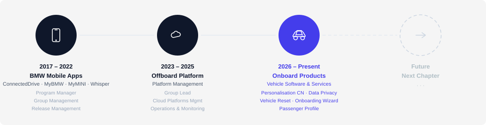
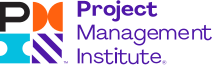
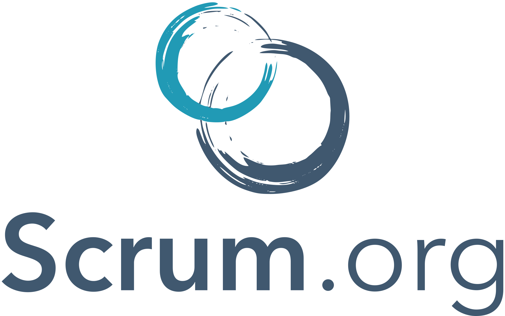
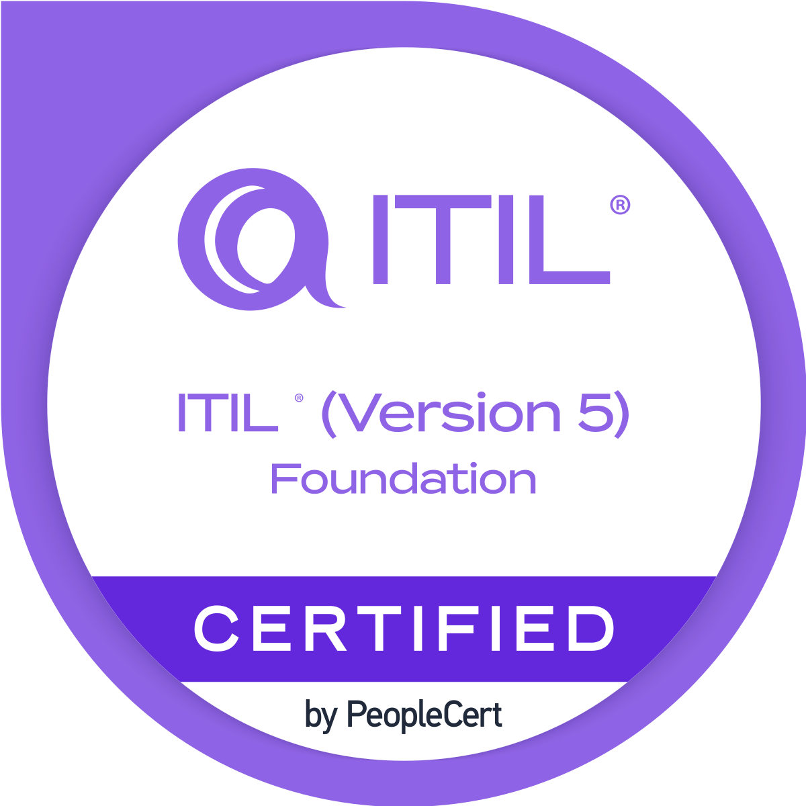

<!-- Your title -->
## 👋 Hi, there. I'm from China.

### About Me 

**Diligent** manager with proven ability to manage and lead teams effectively. Successfully implemented process improvements, enhanced operational efficiency and team productivity. Demonstrated strong problem-solving and communication skills to drive team success.

**Results-driven** professional focused on driving organizational efficiency through technologies including LLM, Python, AI tools (Copilot, Gemini, etc.). Proven AI-powered and analytical tasks management and workflows optimizations.

### Career

#### German Auto OEM (2017 ~ Present)

#### Before German Auto OEM

***Global Consulting Firm (2005 ~ 2017):***
Business Analysis, Technical Solution Consulting and Delivery Management for various clients (Chemical, Electronics, Manufacturing, etc.). Led cross-functional teams to deliver high-quality solutions on time and within budget.

***India Outsourcing Company (2004 ~ 2005):***
JAVA web developer. Clients include CISCO, PepsiCo, and JP Morgan.

***China State Owned Group (2000 ~ 2004):***
Project Coordinator, WAP Gateway, billing system in telecom industry, and IT support.

### Core Competencies

### Tech Stack

### Certifications

  
  
   

